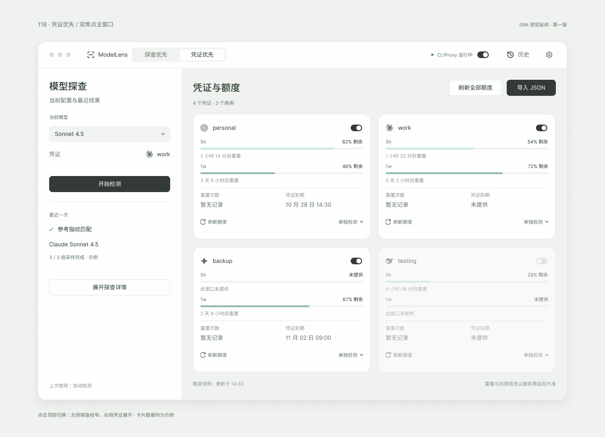

# ModelLens · 模型透镜

一个轻量的模型工具桌面客户端，围绕模型探查、CLIProxy 和凭证额度设计。完整窗口为主，macOS 菜单栏为快捷入口。

**当前版本：0.1.1 · 第一阶段本机 Mac 预览版。** 本版本真实实现的是“发现已运行的 CLIProxy、记住程序和目录”以及桌面 UI。凭证卡片、额度和检测结果为明确标识的示例，不代表已接入真实接口。

## 目录

- [当前功能与边界](#当前功能与边界)
- [界面](#界面)
- [快速开始](#快速开始)
- [自动发现与记忆](#自动发现与记忆)
- [开发与构建](#开发与构建)
- [项目结构](#项目结构)
- [验证](#验证)
- [数据与隐私](#数据与隐私)
- [更新和卸载](#更新和卸载)
- [后续计划](#后续计划)
- [参与贡献与许可](#参与贡献与许可)

## 当前功能与边界

| 能力 | 0.1.1 状态 |
| --- | --- |
| CLIProxy 发现 | 真实：启动时、每 30 秒和手动刷新时，检查当前用户已运行的进程 |
| 位置记忆 | 真实：保存程序路径、所在目录、可读取的工作目录及上次发现时间 |
| 运行状态 | 真实：区分运行、已记住但未运行、检查失败时的状态未知；仅代表进程存在，不代表 API 健康 |
| 主窗口 | 已实现：09A 风格、探查优先／凭证优先、320ms 布局切换及减少动态效果降级 |
| 菜单栏 | 已实现：左键快捷面板，右键打开窗口／退出；关闭窗口后继续驻留 |
| 模式偏好 | 已实现：记住焦点布局、自动／手动模式及示例模型选择 |
| 凭证与额度 | UI 示例：5h／1w、重置和到期信息、局部示例开关；不读取真实账号 |
| JSON 导入 | 只读界面预览，选择文件与提交按钮禁用，不接收真实凭证 |
| 模型探查 | 界面预览；手动文本只保留在当前窗口，不调用模型或执行指纹分析 |
| 启停 CLIProxy | 本阶段不实现，不启动、停止、重启或接管用户现有服务 |

“开软件自动启动 CLIProxy”仍属于后续计划；第一阶段按最新需求收敛为**自动发现已运行服务**。不用先迁移现有服务或调整其配置。

## 界面



上图是已确认的视觉参考，账号、额度和日期均为示例。当前实现保留小字号、灰绿底色、厂商图标、细边框和双焦点布局。

主窗口卡片显示 5h、1w；菜单栏每行有 5h 显示 5h，否则显示 1w。浅绿／深绿分别表示对应窗口的剩余额度。缺失值显示“未提供”，重置次数缺失显示“暂无记录”，不把未知值当成零。

## 快速开始

本阶段交付目标为本机 Apple Silicon Mac，macOS 13+ 为构建下限。Intel Mac、Windows 暂未交付或验证。

有本机构建产物时，打开 `src-tauri/target/release/bundle/macos/ModelLens.app`；也可将其复制到用户的“应用程序”目录，再双击打开。应用菜单栏图标为简约的取景框与圆形。

1. 用原来的方式启动 CLIProxy。
2. 打开 ModelLens，标题栏显示发现结果。
3. 点击标题栏服务状态或设置图标，查看程序路径、所在目录、工作目录与 PID；可手动重新检测。
4. 切换“凭证优先”体验卡片布局。所有凭证按钮仅影响示例界面，不会发请求。
5. 关闭窗口继续驻留；菜单栏右键 →“退出 ModelLens”退出，不影响原 CLIProxy。

菜单栏面板使用 macOS 原生菜单材质（NSVisualEffectView），支持透明圆角、系统阴影、随系统明暗切换，点击外部或按 Esc 收起；内部凭证控件仍使用共享 WebView UI。为支持透明 WebView，构建启用 Tauri `macos-private-api`，当前不以 Mac App Store 分发为目标。

当前为本地 ad-hoc 签名预览版，没有 Developer ID 签名、公证或面向公众的自动更新。它不是跨设备签名发行版。

## 自动发现与记忆

只检查当前用户的进程可执行路径，不读取完整命令行、环境变量、配置文件或认证目录。使用系统 `ps` 与 `lsof`，每次系统命令检查有超时限制。

识别范围：可执行文件名为 `cliproxyapi`、`cli-proxy-api`、`cliproxy` 及对应 `-plus` 名称；另兼容位于名为 CLIProxy 的目录下的 `cpa` 开发程序。无关目录中的同名 `cpa` 不会被自动认领。

目录说明：

- 普通程序的“所在目录”是可执行文件父目录。
- `.dev/cpa` 开发构建的“所在目录”按约定上移到项目目录，同时单独保留真实工作目录。
- 系统不允许读取工作目录时，显示缺失并提示；不会猜测配置或凭证目录。
- 多个实例分别显示，不自动选择、连接或操作其中一个。
- 服务退出后仍保留历史位置，显示“已记住 · 未运行”。位置文件损坏时保留原文件并提示，不静默覆盖。

记忆文件位于当前用户的 `~/Library/Application Support/io.modellens.desktop/discovery.json`，只含路径与时间等元数据，不保存 PID 为永久运行状态。数据目录权限为 0700，写入文件权限为 0600，并以临时文件替换保存。

## 开发与构建

技术栈：**Tauri 2 + Rust + React + TypeScript + Vite**。UI 用自有组件和 CSS 变量还原设计，没有新增服务端或数据库。

前置环境：

- macOS、Xcode Command Line Tools。
- Node.js 24、pnpm 10.10.0。
- Rust 1.89；Cargo 配置按当前 Rust 版本选择兼容依赖。Tauri Rust 与 JS 包保持相同次版本。

依赖以 `pnpm-lock.yaml` 和 `src-tauri/Cargo.lock` 锁定；仓库不包含 node_modules 或编译产物。

```sh
git clone https://github.com/xieyuqiyu-source/model-lens.git
cd model-lens
pnpm install --frozen-lockfile

# 桌面开发：Vite + Tauri，自动发现真实本机进程
pnpm desktop

# 仅浏览器 UI 预览，不能发现本机进程
pnpm dev

# 类型检查及 Rust 编译检查
pnpm check

# 进程识别和持久化测试，不操作真实服务
pnpm test

# 生成本机架构的 Release .app
pnpm package
```

开发服务器只绑定 `127.0.0.1:1420`，端口占用时失败，不自动结束占用进程。桌面发行版使用内嵌静态资源，不依赖开发服务器。前端开发支持 Vite HMR；Rust 变更由 Tauri 开发流程重建。重新打包不会改变已运行的旧应用，需退出 **ModelLens 自身** 后再打开新版，CLIProxy 无需重启。

## 项目结构

| 位置 | 用途 |
| --- | --- |
| `src/App.tsx` | 主窗口、菜单栏视图与局部 UI 状态 |
| `src/features/service/` | Tauri 调用、发现状态与服务信息面板 |
| `src/features/credentials/` | 明确标记的示例凭证、额度卡片、导入预览 |
| `src/features/probe/` | 自动／手动模式和探查 UI |
| `src/components/`、`src/styles/` | 共享控件、09A 样式 |
| `src-tauri/src/discovery.rs` | 只读进程发现、位置持久化及测试 |
| `src-tauri/src/main.rs` | 窗口、托盘、单实例和 IPC 命令 |
| `public/brands/`、`docs/licenses/` | 厂商图标与第三方许可 |

## 验证

自动化测试覆盖：已知可执行路径及带空格目录、误识别排除、已停止服务保留但不标为运行、去重、目录推断、缓存往返和损坏保留。单元测试仅使用合成数据及临时目录。

本机验收范围及结论见 [0.1.0 验收记录](docs/verification-0.1.0.md) 和 [0.1.1 菜单栏修正](docs/verification-0.1.1.md)。跨平台、真实模型调用、真实额度和凭证接口未验收，不能从示例 UI 推断已支持。

## 数据与隐私

- 没有读取 API Key、配置密钥或现有认证文件；不改网络代理、绑定地址或 CLIProxy 配置。
- 本版本没有模型、额度或凭证管理网络请求；不会产生模型采样费用。
- 服务位置仅保存在应用本地数据目录，界面偏好保存在应用 WebView 的 localStorage；手动输入不持久化。
- 开关只改变当前窗口中的示例账号；示例开关不跨窗口同步，后续真实接口接入时统一状态源。
- 无遥测、云同步和登录系统。不应提交本机位置文件、凭证、未脱敏日志或用户输入。

## 更新和卸载

更新：拉取仓库、安装锁定依赖、重新打包，退出 ModelLens 后替换 `.app`。关闭／退出 ModelLens 都不停止已运行的 CLIProxy。

卸载：先退出 ModelLens，再移除 `.app`。如要同时清除记住的位置，可自行删除上文的应用数据目录；界面偏好属于系统 WebView 的应用网站数据。本项目不提供自动删除真实凭证或上游数据的功能。

## 后续计划

在当前版本上逐步开发，不重新另起项目：

- 接入已识别服务的管理认证与安全存储。
- 核对各厂商真实额度、重置和到期字段，替换示例数据。
- JSON 导入、真实账号开关及主窗口／托盘统一状态。
- 手动模型指纹分析，再接入单凭证自动检测与串行批量任务。
- 验证受管服务的自动启动；不自动接管外部进程。
- 最后扩展 Intel Mac、Windows、签名和发布。

## 参与贡献与许可

仓库：https://github.com/xieyuqiyu-source/model-lens 。问题请通过 Issues 提供系统、架构、版本和复现步骤，勿附带真实凭证或未经脱敏的日志。

项目发布许可证尚未选定，公开可见不等同于授予开源许可。第三方资产许可见 [THIRD_PARTY.md](docs/THIRD_PARTY.md)，厂商图标不代表合作或背书。
