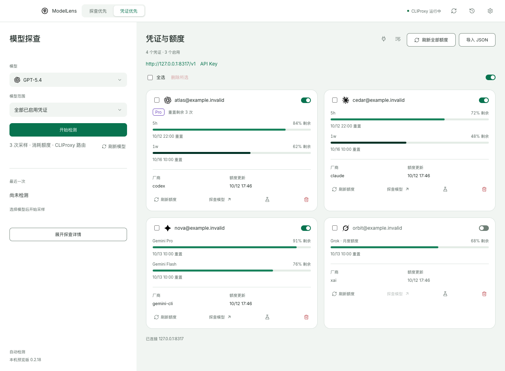
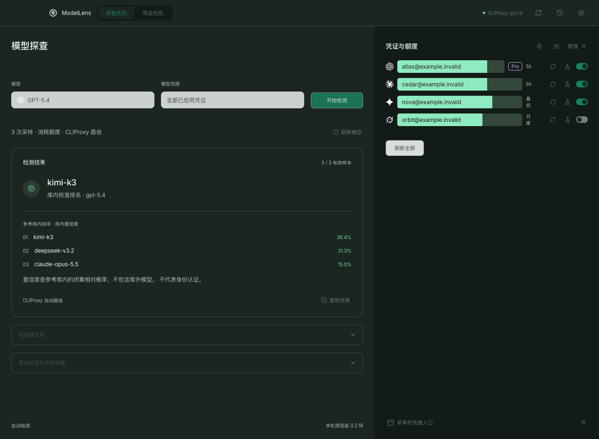
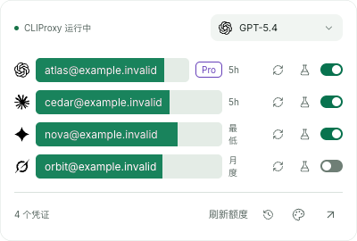

# ModelLens · 模型透镜

把模型探查、账号状态和剩余额度放进一个轻量的 macOS 客户端。

ModelLens 面向使用 **CLIProxy** 的开发者：在主窗口查看模型目录、比较采样结果和管理凭证，也可以从菜单栏快速确认各账号的额度与状态。应用使用 **Tauri 2 + Rust + React + TypeScript**，凭证操作由 Rust 后端处理，前端负责展示与交互。

**当前版本：0.2.23 · 已交付 Apple Silicon Mac · 公开源码仓库**

[快速开始](#快速开始) · [界面预览](#界面预览) · [开发与验证](#开发与验证) · [完整使用说明](docs/usage.md) · [最新验证记录](docs/verification-0.2.23.md)

## 界面预览

以下截图来自 **0.2.18 实际前端界面的浏览器演示环境**。账号、额度、服务状态和采样输入均为合成数据，不含真实凭据；模型排名用于展示交互，不代表实测准确率。菜单栏图为面板内容截图，不包含 macOS 原生外壳。

### 凭证优先：集中查看账号与额度

厂商图标、账号等级、启用状态和额度周期同屏展示；支持单个或批量管理，并在写入前后核实状态。



### 探查优先：采样、参考库排名与原始记录

从 CLIProxy 实时模型目录选择型号，点击后采样；结果保留库内排名、原始回答和历史。浅色、深色及跟随系统可选，另有三套主题色。



### 菜单栏：随手查看剩余额度

400 × 270 紧凑面板展示账号、周期、剩余额度与快捷操作，与主窗口共用会话；账号较多时列表可滚动。



## 可以做什么

| 场景 | 当前能力 |
| --- | --- |
| 查看可用模型 | 读取 CLIProxy 实时模型目录，保留服务的别名与前缀，支持按凭证筛选目录 |
| 探查模型行为 | 最多三次采样，复用 58 个型号参考库进行本地分析，显示前三名及原始采样 |
| 指定账号测试 | 最多三个账号同时测试，每个账号内部串行采样，主窗口与菜单栏共享任务与最近十条记录 |
| 管理凭证 | 按 Codex / Gemini / Claude / Grok / Antigravity 分组，单个与组内批量启停、JSON 导入、确认删除 |
| CPA 快捷入口 | 打开管理页；快进拉取、编译与重启；本机发现、独立启动和官方源码安装 |
| 查看额度 | 支持 Codex、Claude、Grok、Gemini CLI、Antigravity 已适配接口；按服务实际返回的周期或分组展示 |
| 保留额度状态 | 本地缓存、手动刷新、已连接时每五分钟后台刷新；失败保留旧值并标注错误 |
| 使用桌面快捷入口 | 主窗口双布局、菜单栏面板、明暗主题、翡翠绿 / 海湾蓝 / 鸢尾紫配色 |

**探查结果是参考库内的相对排名，不是厂商或模型身份认证。** 模型调用可能消耗额度，只有用户主动发起探查时才采样。CLIProxy 自身的路由、重试或提示词改写可能影响结果；ModelLens 不修改这些设置。

## 当前交付范围

- **已验证**：Apple Silicon Mac；构建目标最低 macOS 13，本机验收环境 macOS 26.5.2。
- **尚未交付**：Intel Mac、Windows、凭证到期查询、自动更新。
- **签名状态**：本地 ad-hoc 签名预览版，未进行 Apple Developer ID 签名或公证。
- **兼容性边界**：浏览器与合成 HTTP 测试已覆盖主要流程，不等同于所有厂商真实账号均已实测。

## 快速开始

### 1. 从源码构建

准备 Xcode Command Line Tools、Node.js 24、pnpm 10.10.0 和 Rust 1.89。当前项目使用锁文件固定依赖。

```sh
git clone https://github.com/xieyuqiyu-source/model-lens.git
cd model-lens
pnpm install --frozen-lockfile
pnpm package
```

构建后的应用位于 `src-tauri/target/release/bundle/macos/ModelLens.app`。复制到自己的“应用程序”目录后打开；打包版已包含前端资源，不需要另开 Node.js 服务。

### 2. 连接本机 CLIProxy

1. 使用原来的方式启动 CLIProxy。
2. 打开 ModelLens，在连接窗口填写本机管理端口（默认 `8317`）和 **CLIProxy 管理密钥**。
3. 连接后查看凭证与模型目录；额度先恢复本地缓存，之后每五分钟刷新，也可以手动刷新。
4. 在“探查优先”选择模型并开始检测，或在凭证列表点击试管图标测试指定账号。

当前仅连接 `http://127.0.0.1:<端口>`。管理密钥与厂商 API Key 不同，请直接在应用内输入。

### 3. 理解本地数据

连接成功后，端口与管理密钥以**明文 JSON**保存在应用专用目录，目录权限 `0700`、文件权限 `0600`；应用不启用云同步，也不使用钥匙串。

| 数据 | 位置或生命周期 |
| --- | --- |
| 管理连接 | `~/Library/Application Support/io.modellens.desktop/connection.json` |
| 额度缓存 | 同目录 `quota-cache.json`；仅保存白名单额度字段，账号身份使用散列键 |
| 采样与历史 | 当前应用会话内保留，退出不保存回答 |
| 界面偏好 | 本机 WebView 存储，记住布局、明暗模式与主题 |

“断开连接”保留本机记录；“忘记密钥并断开”删除本应用的连接文件。不会因此删除 CLIProxy 凭证。关闭主窗口会隐藏窗口，菜单栏右键菜单中的“退出 ModelLens”才会退出应用。

凭证优先页的分组会记住上次选择；全选、删除、批量开关和手动额度刷新仅作用于当前分组，后台定时刷新仍覆盖全部账号。代理地址/API Key 右侧提供“CPA 管理”和“更新并重启”。更新对应运行进程的源码仓库，只允许快进；编译完成后才停止旧服务，新版启动失败尝试恢复旧程序和配置。本机 CLIProxy 弹窗根据实际进程状态显示“关闭 / 启动”，另提供安装入口；路径默认收起；版本区显示本地编译程序、源码和当前跟踪分支远端的提交号，打开弹窗或点击“检查更新”时获取远端引用，不合并源码。同步状态区分落后、领先、分叉、本地修改和源码已更新但程序未编译；检查失败保留已知版本并提示无法确认。版本区可直接点击“更新并重启”，沿用主界面的更新流程；编译、重启成功后自动重新核对并显示成功提示。下方命令日志记录本次运行最近 100 条步骤与结果，安装路径支持选择或手填；安装前检查已有进程、目录与端口，避免重复安装。首次接管当前 `dev` 启动器时会停止它及 CPM，随后独立运行 CPA；退出 ModelLens 不会关闭 CPA。安装/编译需要 Git 与 Go 1.26+，关闭面板不影响后台任务，退出应用不保证未完成任务继续。

更多导入、删除、额度解析、错误处理、旧版本升级和卸载说明，见 [完整使用说明](docs/usage.md)。

## 技术实现

```text
React / TypeScript：主窗口、菜单栏、主题与状态展示
        │ Tauri IPC：命令与事件
Rust：共享管理会话、并发控制、本地缓存、请求与写入核实
        │ 回环地址 HTTP
本机 CLIProxy：凭证、模型目录、服务路由与厂商代请求

本地 Web Worker：模型参考库分析，避免阻塞界面
```

- 主窗口与菜单栏共享 Rust 内存会话，统一账号排序、开关状态、额度和快捷探查历史。
- 管理网络请求固定回环地址，禁用代理及重定向；厂商 Token 由 CLIProxy 注入，ModelLens 不读取厂商认证文件。
- 客户端 API Key 只在 Rust 内存使用；主动点击复制时由后端写剪贴板，不经前端展示或日志。
- 探查任务最多三个账号并行；网络采样不持有全局管理锁，额度定时刷新遇到探查时跳过当前轮。
- 主题颜色集中定义于 `src/features/appearance/tokens.json`；布局切换采用 220ms 渐隐渐显。
- 探查内核沿用已锁定的参考实现与数据；来源和许可见 [探查内核来源](src/features/probe/vendor/UPSTREAM.md) 与 [第三方说明](docs/THIRD_PARTY.md)。

## 开发与验证

```sh
pnpm dev       # 浏览器 UI，127.0.0.1:1420；不连接真实管理接口
pnpm desktop   # Tauri 桌面开发
pnpm build     # TypeScript 检查与前端生产构建
pnpm test:ui   # 界面逻辑与主题等测试
pnpm test      # Rust 单元与合成 HTTP 测试
pnpm check     # TypeScript + Rust 编译检查
pnpm package   # 当前 Mac 架构的 .app
```

0.2.18 的交付记录包含 **79 项 Rust 测试、23 项界面逻辑测试**及 WebKit / Chromium 合成场景验证；这些是该版本的验收结果，不代表新提交已自动执行全部检查。完整过程见 [0.2.18 验证记录](docs/verification-0.2.18.md)。

浏览器回归使用 `tests/fixtures/credentials-ipc.js` 和合成 HTTP，不访问真实凭据、不发起付费调用。运行方式见 [使用说明中的开发章节](docs/usage.md#开发和构建)。

| 目录 | 内容 |
| --- | --- |
| `src/features/probe/` | 模型目录、采样编排、参考库分析与历史 |
| `src/features/credentials/` | 连接、共享状态、额度与凭证管理 |
| `src/features/appearance/` | 主题令牌与偏好 |
| `src-tauri/src/management/` | Rust 管理会话、HTTP、并发、持久化与测试 |
| `tests/` | 界面逻辑与合成浏览器场景 |
| `docs/` | 使用说明、验证记录、截图与第三方许可 |

贡献前请阅读 [AGENTS.md](AGENTS.md) 和 [当前界面约定](DESIGN.md)，保留已有视觉风格与操作边界。

## 反馈与许可

在 [GitHub Issues](https://github.com/xieyuqiyu-source/model-lens/issues) 提交系统、版本、复现步骤和预期结果。请使用演示数据截图，不提交管理密钥、厂商 Token、真实认证 JSON 或未脱敏日志。

项目目前是**公开源码仓库，尚未选定项目发布许可证**；公开可见不等于授予开源许可。第三方代码、字体和图标遵循各自许可，详见 [THIRD_PARTY.md](docs/THIRD_PARTY.md)。
